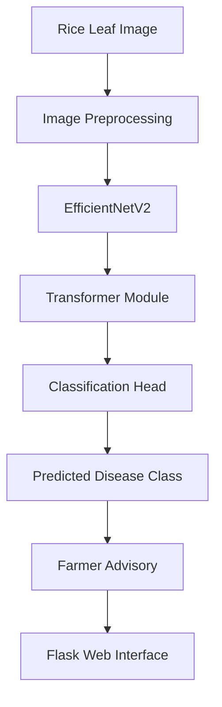

<div align="center">

# 🌾 AgriFusion Net

### AI-Powered Rice Leaf Disease Classification & Farmer Advisory


<p>
  
  
  
  
</p>

<p>
  
  
  
</p>

**Transforming rice crop disease identification with AI-driven image analysis.**

</div>

---

## 🌱 About the Project

**AgriFusion Net** is an AI-based smart agriculture project designed to classify rice leaf diseases from images and provide supporting farmer advisory information through a web application.

The project combines **EfficientNetV2** for image feature extraction with a **Transformer-based architecture** to explore effective visual feature learning. A Flask interface connects the model with an accessible user experience.

The goal is to support early disease recognition and help farmers understand potential next steps.

> 🚧 Model performance and supported disease classes will be documented after training and evaluation.

## ✨ Key Features

- 🌿 Rice leaf image upload and classification
- 🧠 EfficientNetV2-based feature extraction
- 🔬 Transformer-based visual learning
- 📊 Model training and evaluation workflow
- 🌾 Farmer advisory information for supported disease classes
- 🌐 Flask-based web application
- 📱 Simple, user-friendly interface
- 🛠️ Extensible architecture for future improvements

## 🧠 AI Architecture



*The diagram represents the intended workflow. The actual implementation should match the modules in the project source code.*

## 🛠️ Tech Stack

| Technology | Purpose |
|---|---|
| Python | Core programming |
| TensorFlow / Keras | Deep learning |
| EfficientNetV2 | Visual feature extraction |
| Transformer | Feature representation |
| OpenCV / Pillow | Image preprocessing |
| Flask | Web application |
| NumPy | Numerical operations |
| Matplotlib | Training and evaluation visualizations |

## 📂 Project Structure

```text
AgriFusion-Net/
├── app.py
├── train.py
├── evaluate.py
├── requirements.txt
├── README.md
├── models/
│   └── trained_model.keras
├── dataset/
│   └── rice_leaf_disease/
├── static/
│   ├── css/
│   ├── js/
│   └── uploads/
├── templates/
│   ├── index.html
│   └── result.html
├── utils/
│   ├── preprocessing.py
│   └── advisory.py
└── outputs/
    ├── plots/
    └── evaluation/
```

*Adjust this structure to match the actual files in your repository. The trained model and dataset folders may be generated or supplied separately.*

## ⚙️ Installation & Setup

### 1. Clone the repository

```bash
git clone https://github.com/MohammedSalahAfzal/AgriFusion-Net.git
cd AgriFusion-Net
```

### 2. Create a virtual environment

```bash
python -m venv venv
```

Activate it on Windows:

```bash
venv\Scripts\activate
```

### 3. Install dependencies

```bash
pip install -r requirements.txt
```

### 4. Prepare the dataset

Place your rice leaf disease dataset inside the dataset directory, following the class-folder structure expected by your training script.

Example:

```text
dataset/
└── rice_leaf_disease/
    ├── Class_1/
    ├── Class_2/
    └── Class_3/
```

Replace these example class names with the actual classes in your dataset.

### 5. Train the model

```bash
python train.py
```

### 6. Launch the web application

```bash
python app.py
```

Open the local URL displayed in your terminal, commonly `http://127.0.0.1:5000/` for a Flask development server.

*These commands assume your repository contains scripts with these names and that their dependencies and paths are configured accordingly.*

## 📈 Model Evaluation

The project should evaluate its trained model using:

- Accuracy
- Precision
- Recall
- F1-score
- Confusion matrix
- Per-class performance

No performance figures are reported here because the trained model's verified evaluation results have not yet been provided.

## 🚀 Future Enhancements

- 🌍 Multilingual farmer advisory
- 📱 Responsive mobile-first interface
- ☁️ Cloud deployment
- 📷 Camera-based leaf capture
- 📊 Interactive disease statistics dashboard
- 🌾 Expanded crop disease coverage

## ⚠️ Disclaimer

AgriFusion Net is an experimental agricultural AI project. Predictions depend on dataset quality and model performance. Advisory information is intended as guidance, not a substitute for assessment by a qualified agricultural expert.

## 👨‍💻 Developer

**Mohammed Salah Afzal**

B.E. Computer Science and Engineering | AI & Data Science Projects

<p>
  <a href="https://github.com/MohammedSalahAfzal">
    
  </a>
  <a href="https://www.linkedin.com/in/mohammed-salah-afzal-27860031a">
    
  </a>
</p>

---

<div align="center">

### 🌾 Innovating Agriculture with Artificial Intelligence

*Building smarter tools for a more sustainable agricultural future.*


</div>
